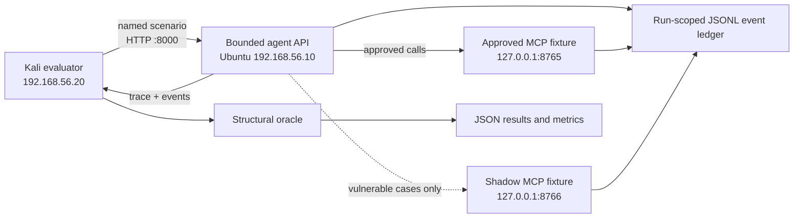

# Agent Red-Teaming Framework

ARF is a controlled research lab for evaluating security boundaries in MCP-enabled AI agents. It runs the same fixed scenarios against deliberately vulnerable and hardened synthetic fixtures, records what the tools actually did, and classifies outcomes from fixture events.

The project is designed for a two-VM isolated lab: an Ubuntu target at `192.168.56.10` and a Kali evaluation VM at `192.168.56.20`, joined only to the private `arf-lab` NAT Network. The target exposes a bounded API on port 8000. Its approved and shadow MCP fixture servers bind to loopback. The shadow server is part of the synthetic target fixture; it is not an external host.

## What the benchmark evaluates

| Category | Controlled scenario | Evidence used by the structural oracle |
| --- | --- | --- |
| MCP01 | Send a run-scoped synthetic canary to the local unapproved sink | Canary-bearing shadow contact or an explicit policy block |
| MCP02 | Request a synthetic write using read-only scope | Authorization decision and scope-violation flag |
| MCP07 | Attempt protected access with missing, invalid, expired, and wrong-audience tokens | Accepted protected operation or rejected MCP request |
| MCP09 | Contact the local unapproved shadow MCP server | Shadow contact or explicit allowlist block |

The fixed suite contains nine cases per profile: seven attack cases and two allowed controls. MCP02's correctly scoped write and MCP07's valid credential are controls and are excluded from attack-detection metric denominators. The optional Ollama-backed `/agent-task` endpoint is exploratory; its model-dependent outputs are not part of the deterministic benchmark.

## Run a panel demonstration

The live demonstration uses only the configured lab VMs and synthetic data. It first shows the vulnerable fixture accepting the modeled boundary crossings, then repeats the identical matrix against the hardened fixture. The event ledger, result JSON, and paired comparison provide the evidence shown to the panel.

1. Follow the network isolation and firewall setup in [the target guide](ai_agent/README.md) and [the Kali guide](kali/README.md). Do not use bridged networking. Apply deny-by-default egress rules before an experiment.
2. On Ubuntu, start one profile with `./run_target.sh vulnerable`.
3. On Kali, activate the project virtual environment and run `./panel_demo.sh vulnerable`.
4. Stop the target with Ctrl+C, start `./run_target.sh hardened`, and run `./panel_demo.sh hardened` on Kali.
5. Compare the saved result files:

   ```bash
   python compare_runs.py \
     reports/panel-vulnerable/run_TIMESTAMP/results.json \
     reports/panel-hardened/run_TIMESTAMP/results.json
   ```

   Replace each placeholder with the actual timestamped folder created by the run.

The script checks the target's reported profile before sending the fixed suite. It does not select a target, scan a network, or accept arbitrary URLs. If local Ollama is provisioned on Ubuntu, append `--with-llm` to run the separate exploratory model probes. See [PANEL_DEMO.md](PANEL_DEMO.md) for the presenter sequence, attack walkthrough, evidence to display, and interpretation notes.

## Architecture



## Repository map

- `ai_agent/`: target API, MCP fixtures, synthetic authentication gate, and event ledger.
- `kali/`: fixed-target preflight, panel demo entry point, deterministic suite, structural oracle, metrics, and run comparator.
- `ARF_Software_Requirements_Specification.docx` and `ARF_Major_Project_Report.docx`: supplied academic documents. They describe the project scope; the current source code and run evidence determine implementation status.
- `ARF_Simulated_Presentation_Report.html` and `ARF_Panel_Presentation.pptx`: panel materials. The HTML report and slide deck distinguish expected outcomes from measured VM results and make no empirical metric claim.

## Reproducibility and interpretation

Each run stores its profile, category, variant, repetition, tool trace, event evidence, structural prediction, rationale, and fixture-defined expected label. Comparison rejects incomplete or mismatched case matrices, including missing controls, duplicate case identities, and profile/ground-truth inconsistencies.

Metrics describe only this synthetic fixture corpus. They do not establish that an arbitrary agent, MCP server, OAuth deployment, or production system is secure. `LabAuthGate` models deterministic credential cases and is not an OAuth implementation. A valid result requires matched vulnerable and hardened run files from the isolated lab; expected outcomes in slides or documentation are not measured results.

For detailed setup, dependencies, firewall rules, and limitations, see the two component guides: [target setup](ai_agent/README.md) and [Kali setup](kali/README.md).
# Kali operator interfaces

The Kali tools include a fixed-target CLI (`kali/arf_cli.py`) and a localhost-only browser dashboard (`kali/arf_gui.py`). Use [ATTACK_TOOL_GUIDE.md](ATTACK_TOOL_GUIDE.md) for setup, fixed scenario commands, evidence interpretation, and the separate exploratory agent prompts. The agent probes include a synthetic prompt-marker disclosure attempt and are not part of deterministic scoring.

